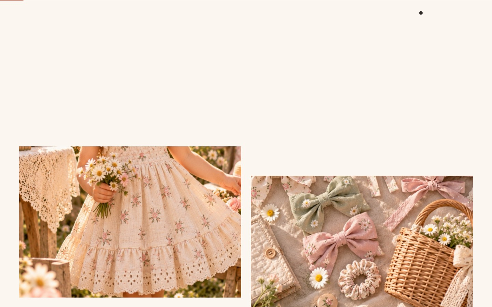
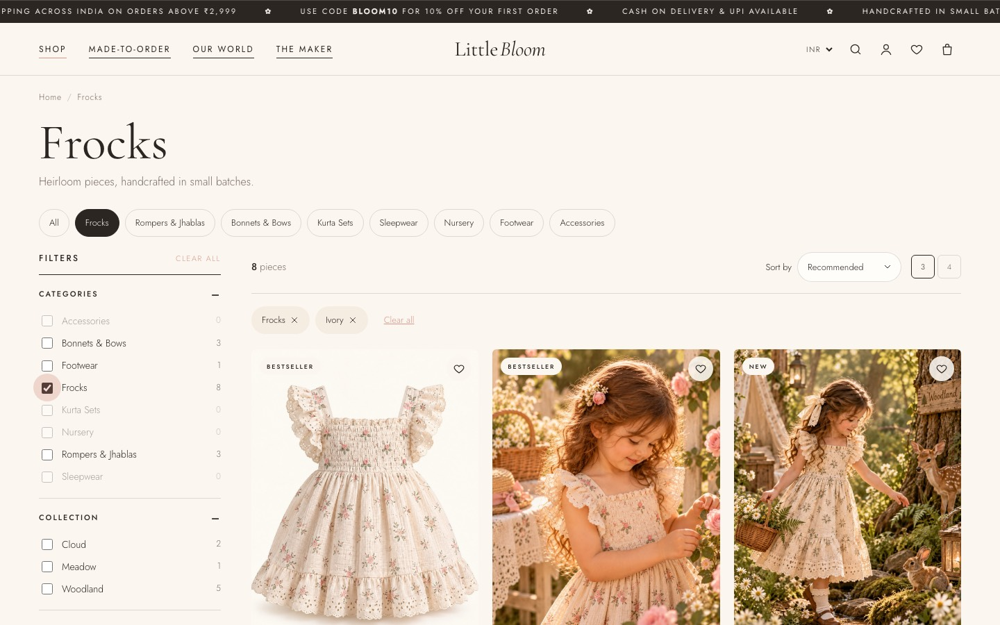
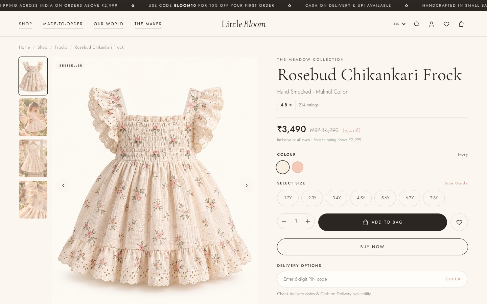
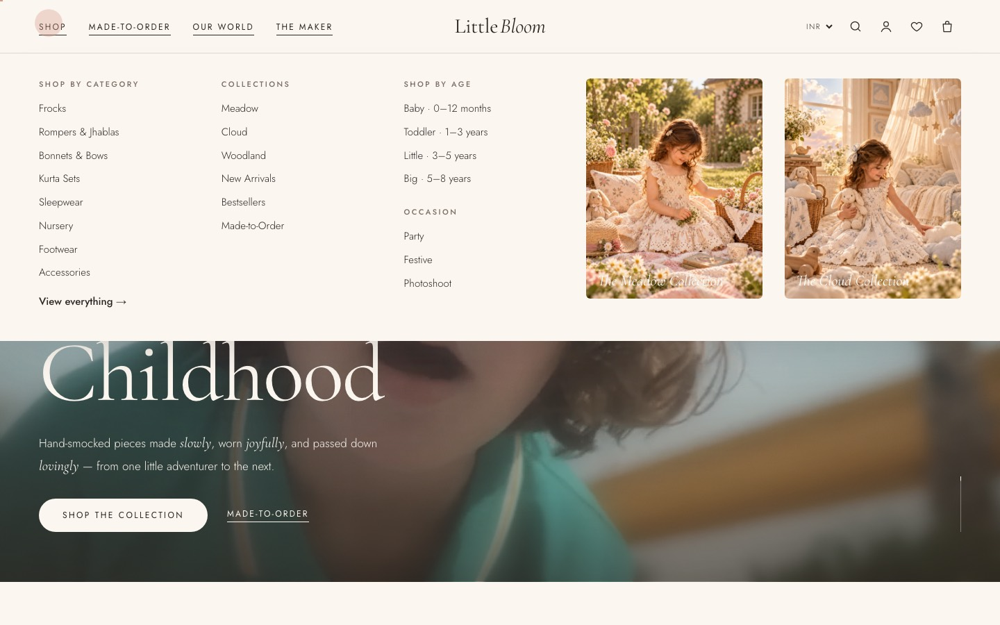
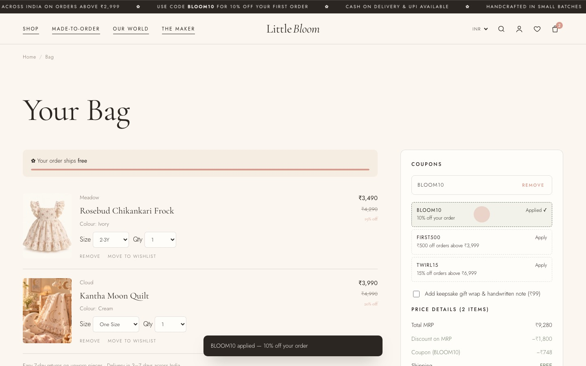
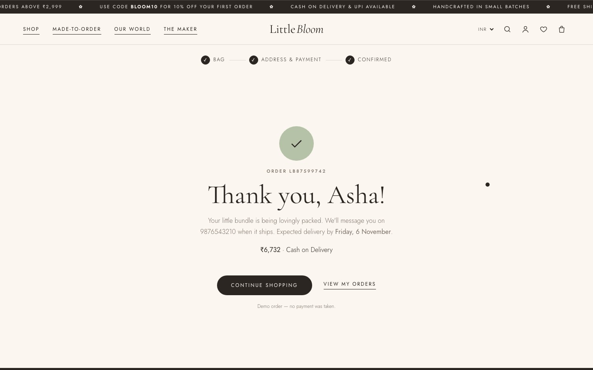
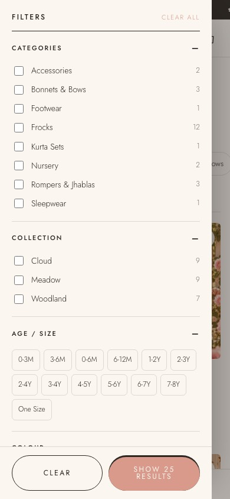
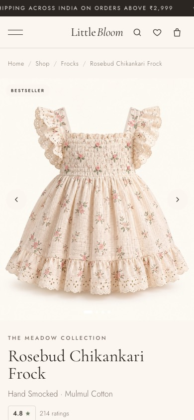
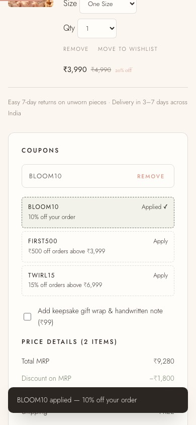

<div align="center">

<br>

# 🌸 House of Tarigai

### *House of Heirloom Childhood*

**A children's boutique storefront with hand-smocked frocks, chikankari, kantha and natural dyes, built to feel like a fashion editorial.**

<br>


<br>

[**Features**](#-features) · [**Screenshots**](#-a-look-around) · [**Quick start**](#-quick-start) · [**Deploy**](#-deploy-to-vercel) · [**Structure**](#-project-structure) · [**Customise**](#-make-it-yours)

<br>

</div>

---

## ✨ Overview

House of Tarigai is a **frontend-only demo store** with a soft, editorial look. Every page shares one header, footer, search, mega menu and bag drawer. Bag, wishlist, account and orders are stored in the browser, so the whole store works **with no backend and no build step**. Open `index.html` or push the folder to Vercel.

> 🎀 Prices in **₹ INR** (Indian number format), all Indian states at checkout, UPI / Card / Net Banking / COD, and PIN code delivery checks.

<br>

## 🌷 Features

<table>
<tr>
<td width="50%" valign="top">

### 🎬 Cinematic home page
- Muted, looping hero film with **soft glow, zoom blur, film grain and vignette**, so it reads as part of the page rather than an embedded video player
- Intro loader → headline reveal, word by word
- Draggable collection sliders with inertia
- Pinned **horizontal-scroll lookbook**
- Parallax imagery, clip-path reveals, animated counters
- Custom cursor and magnetic buttons

</td>
<td width="50%" valign="top">

### 🛍️ Myntra / AJIO-style shop
- **10 filter groups**: category, collection, age/size, colour swatches, price range slider, craft, fabric, occasion, discount, rating
- Live counts per filter option
- Removable filter chips plus *Clear all*
- 7 sort options · 3 / 4 column grid · load more
- Filters kept in the **URL**, so links can be shared
- Bottom-sheet filter drawer on mobile

</td>
</tr>
<tr>
<td valign="top">

### 👗 Product page
- Gallery with thumbnails, **zoom that follows the mouse** and swipe on touch screens
- Colour and size pickers with a size guide modal
- MRP, price and *% off* · PIN code delivery estimate
- Offers, accordions, sticky buy bar on mobile
- *Complete the Look*, *You May Also Like*, *Recently Viewed*

</td>
<td valign="top">

### 💳 Bag & checkout
- Slide-out bag drawer with a **free-shipping progress bar**
- Coupons: `TARIGAI10` · `FIRST500` · `TWIRL15`
- Gift wrap, move to wishlist, size and quantity edits
- Checkout checks every field (10-digit phone, 6-digit PIN)
- Standard or express delivery · UPI / Card / Net Banking / COD
- Order confirmation, then order history in **My Account**

</td>
</tr>
</table>

**Also included:** live search overlay (`/` to open, `Esc` to close) · mega menu · wishlist · demo login and sign-up · currency switcher · toasts · Made-to-Order enquiry form · FAQ · size chart · 404 page · works on phone, tablet and desktop with no sideways scrolling.

<br>

## 📸 A look around

<table>
<tr>
<td colspan="2"><p align="center"><sub><b>Home</b>: category tiles and collections</sub></p></td>
</tr>
<tr>
<td width="50%"><p align="center"><sub><b>Shop</b>: filters, chips and sorting</sub></p></td>
<td width="50%"><p align="center"><sub><b>Product</b>: gallery, sizes, offers</sub></p></td>
</tr>
<tr>
<td><p align="center"><sub><b>Mega menu</b></sub></p></td>
<td><p align="center"><sub><b>Bag</b>: coupons and price breakdown</sub></p></td>
</tr>
<tr>
<td colspan="2"><p align="center"><sub><b>Checkout</b>: order confirmed</sub></p></td>
</tr>
</table>

<details>
<summary><b>📱 Mobile screenshots</b></summary>
<br>
<p align="center">

&nbsp;

&nbsp;

</p>
</details>

<br>

## 🚀 Quick start

No install and no build step:

```bash
git clone https://github.com/hapkonic-Ai/Boutique-marketplace.git
cd Boutique-marketplace

# open the site directly…
open index.html

# …or serve it (recommended, so clean URLs and the video work like production)
npx serve .
```

<br>

## ▲ Deploy to Vercel

[](https://vercel.com/new/clone?repository-url=https://github.com/hapkonic-Ai/Boutique-marketplace)

1. Import this repo at **vercel.com/new**
2. Framework preset: **Other**, with build command and output directory left empty
3. Click **Deploy** 🎉

The included [`vercel.json`](vercel.json) turns on **clean URLs** (`/shop`, `/product?id=…`) and long-lived caching for images and video.

<br>

## 🗺️ Pages

| Page | File | What's there |
|---|---|---|
| 🏠 Home | `index.html` | Hero film, categories, collections, lookbook, story, Instagram |
| 🛍️ Shop | `shop.html` | Filters, sorting, grid. Accepts `?category=`, `?collection=`, `?q=` and more |
| 👗 Product | `product.html?id=…` | Gallery, variants, offers, recommendations |
| 👜 Bag | `cart.html` | Line items, coupons, gift wrap, summary |
| 💳 Checkout | `checkout.html` | Contact → address → delivery → payment → confirmation |
| ♡ Wishlist | `wishlist.html` | Saved pieces |
| 👤 Account | `account.html` | Demo login, orders, address, profile |
| ✂️ Made-to-Order | `bespoke.html` | Process, occasions, enquiry form, FAQ |
| 🌿 Our World | `our-world.html` | Story, impact counters, sustainability |
| 🧵 The Maker | `the-maker.html` | Founder, crafts, timeline |
| 💌 Customer Care | `care.html` | FAQ, shipping and returns, size guide, contact |
| 📜 Policies | `policies.html` | Privacy and terms (placeholder text) |
| 🔍 404 | `404.html` | Friendly not-found page |

<br>

## 🧶 Project structure

```
.
├── index.html · shop.html · product.html · cart.html · checkout.html
├── wishlist.html · account.html · bespoke.html · our-world.html
├── the-maker.html · care.html · policies.html · 404.html
├── css/
│   ├── styles.css        # design tokens, type, home page, animations
│   └── shop.css          # store components and inner pages
├── js/
│   ├── data.js           # 🌸 catalogue, collections, coupons, states
│   ├── core.js           # shared layout, bag, wishlist, search, reveals
│   ├── home.js           # sliders, lookbook, loader, hero
│   ├── shop.js           # filter engine and sorting
│   ├── product.js        # gallery, variants, recommendations
│   ├── cart.js           # bag page
│   └── checkout.js       # checkout and orders
├── assets/
│   ├── images/           # editorial and product photography
│   └── video/hero.mp4    # muted hero film
├── docs/                 # hero video script, image list, screenshots
└── vercel.json
```

**How it works:** plain `<script>` files share one `window.LB` namespace, which is why the site runs even from `file://`. State lives in `localStorage` under keys prefixed `lb:`, and every component re-renders on a single `lb:change` event.

<br>

## 🎨 Make it yours

| Want to… | Edit |
|---|---|
| Add or change products, prices, sizes, photos | `js/data.js` → `LB.products` |
| Change coupons or the free-shipping threshold | `js/data.js` → `LB.coupons`, `LB.freeShipAt` |
| Change colours and fonts | `:root` tokens at the top of `css/styles.css` |
| Swap the hero film | Replace `assets/video/hero.mp4` (see `docs/HERO_VIDEO_SCRIPT.md`) |
| Change the header, footer or announcement bar | Layout templates in `js/core.js` |

<br>

## ⚠️ Before going live

- [ ] Replace the demo **ratings and review counts** in `js/data.js`
- [ ] Add the real **footer address and WhatsApp number**
- [ ] Have the **Policies** page reviewed (it's placeholder text)
- [ ] Use a **hero video** you own the rights to
- [ ] Connect a real backend and payment gateway. Checkout is a demo and **takes no payment**

<br>

---

<div align="center">

<sub>Made with 🧵 and a lot of tiny pleats · Handcrafted in India</sub>

</div>
